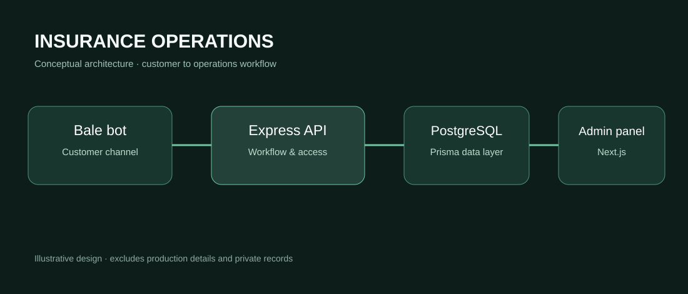

# Insurance Operations Platform

**A connected workspace for insurance service operations.**

[فارسی](README.fa.md) · [Architecture](docs/ARCHITECTURE.md) · [Security & scope](docs/SECURITY.md)

An internal platform for an insurance services operation, bringing together a Persian administration panel, customer records, policy follow-ups, service requests, and a Bale messaging bot. The system connects customer-facing interactions with internal workflows so authorized staff can follow requests throughout their lifecycle.

> **Portfolio showcase only.** Commercial source code and production data are not distributed. The architecture diagram is conceptual, not a verified production screenshot.

## Operational challenge

Customer conversations, policy information, renewal dates, documents, and request status changes are related but are often managed through separate channels. The platform organizes these interactions around shared customer and service-request records.

## Capabilities represented in the reviewed source

- **Persian administration panel:** dashboard, customer records, insurance policies, requests, renewals, users, and configuration.
- **Bale messaging bot:** customer contact and identity flows, service requests, document intake, and follow-up.
- **Request lifecycle:** tracked statuses, change history, staff notes, and customer communications.
- **Permissions:** roles and server-side authorization checks.
- **Policy management:** records, expiration dates, and renewal tracking.
- **Spreadsheet import:** column mapping, preview, validation, and confirmation.
- **Operational controls:** audit records, input validation, session handling, and protected attachments.
- **Localization:** right-to-left layout and Jalali date handling.

These capabilities are described from a source review, not from an independent production audit.

## Technology

**Next.js · React · TypeScript · Express · Prisma · PostgreSQL · Bale Bot API**

## System architecture

The administration interface and Bale integration communicate through a central API and shared data model. [Engineering overview](docs/ARCHITECTURE.md).

## Scope

This is an operations-management platform. The showcase does **not** claim direct policy issuance through an insurer's core system, live access to an insurer's internal database, or an online payment gateway.

## Availability and rights

No deployable application, credentials, private endpoints, client records, or production configuration are included. This is not an open-source release.

© NaarCode. All rights reserved. [Usage terms](RIGHTS.md).

[NaarCode](https://naarcode.com/fa)
